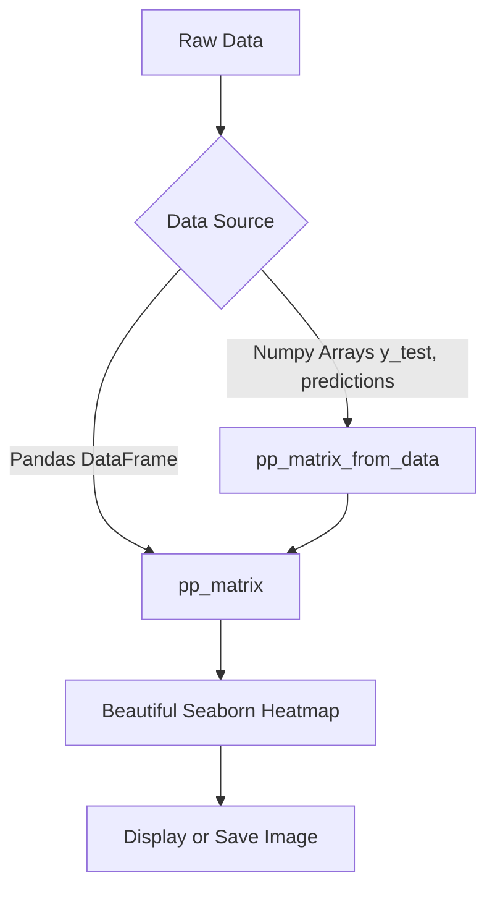

<div align="center">

# ✨ Pretty Confusion Matrix ✨

[](https://pypi.org/project/pretty-confusion-matrix/)
[](https://pypi.org/project/pretty-confusion-matrix/)
[](https://github.com/psf/black)
[](https://pypi.org/project/pretty-confusion-matrix/)
[](https://libraries.io/pypi/pretty-confusion-matrix)
[](https://github.com/wcipriano/pretty-print-confusion-matrix/blob/master/LICENSE)
[](https://pypi.org/project/pretty-confusion-matrix/)

**Plot a beautiful confusion matrix (like Matlab) in Python using seaborn and matplotlib.**

</div>

## 🚀 Quickstart

Install `pretty-confusion-matrix` via pip:

```bash
pip install pretty-confusion-matrix
```

## 🧠 How it Works



## 🎨 Examples

### Plotting from DataFrame

Easily convert your raw confusion matrix arrays into a visually pleasing, easy-to-read diagram!

**Raw Confusion Matrix:**
```python
import numpy as np

array = np.array([[13,  0,  1,  0,  2,  0],
                  [0, 50,  2,  0, 10,  0],
                  [0, 13, 16,  0,  0,  3],
                  [0,  0,  0, 13,  1,  0],
                  [0, 40,  0,  1, 15,  0],
                  [0,  0,  0,  0,  0, 20]])
```

**Pretty Plotted Output:**
```python
import pandas as pd
from pretty_confusion_matrix import pp_matrix

# get pandas dataframe
df_cm = pd.DataFrame(array, index=range(1, 7), columns=range(1, 7))

# colormap: see this and choose your favorite
cmap = 'PuRd'
pp_matrix(df_cm, cmap=cmap)
```

<div align="center">
  
</div>


### Plotting from Vectors

```python
import numpy as np
from pretty_confusion_matrix import pp_matrix_from_data

y_test = np.array([1, 2, 3, 4, 5, 1, 2, 3, 4, 5, 1, 2, 3, 4, 5, 1, 2, 3, 4, 5, 1, 2, 3, 4, 5, 1, 2, 3, 4, 5, 1, 2, 3, 4, 5, 1, 2, 3, 4, 5, 1, 2, 3, 4, 5, 1, 2, 3, 4, 5, 1, 2,
                  3, 4, 5, 1, 2, 3, 4, 5, 1, 2, 3, 4, 5, 1, 2, 3, 4, 5, 1, 2, 3, 4, 5, 1, 2, 3, 4, 5, 1, 2, 3, 4, 5, 1, 2, 3, 4, 5, 1, 2, 3, 4, 5, 1, 2, 3, 4, 5, 1, 2, 3, 4, 5, 1, 2, 3, 4, 5])
predic = np.array([1, 2, 4, 3, 5, 1, 2, 4, 3, 5, 1, 2, 3, 4, 4, 1, 4, 3, 4, 5, 1, 2, 4, 4, 5, 1, 2, 4, 4, 5, 1, 2, 4, 4, 5, 1, 2, 4, 4, 5, 1, 2, 3, 3, 5, 1, 2, 3, 3, 5, 1, 2,
                  3, 4, 4, 1, 2, 3, 4, 1, 1, 2, 3, 4, 1, 1, 2, 3, 4, 1, 1, 2, 4, 4, 5, 1, 2, 4, 4, 5, 1, 2, 4, 4, 5, 1, 2, 4, 4, 5, 1, 2, 3, 4, 5, 1, 2, 3, 4, 5, 1, 2, 3, 4, 5, 1, 2, 3, 4, 5])

pp_matrix_from_data(y_test, predic)
```

<div align="center">
  
</div>

## 🏷️ Using Custom Labels in Axis

You can customize the labels in the axis, whether by DataFrame or vectors.

### From DataFrame
To plot the matrix with text labels in the axis rather than integers, change the `index` and `columns` parameters of your dataframe.

```python
col = ['Dog', 'Cat', 'Mouse', 'Fox', 'Bird', 'Chicken']
df_cm = pd.DataFrame(array, index=col, columns=col)
```

### From Vectors
It's very similar, in this case you just need to use the `columns` param like the example below.

```python
columns = ['Dog', 'Cat', 'Mouse', 'Fox', 'Bird'] 
pp_matrix_from_data(y_test, predic, columns)
```

More information about "_How to plot confusion matrix with string axis rather than integer in python_" in [this Stackoverflow answer](https://stackoverflow.com/a/51176855/1809554).


## 🌈 Choosing Colormaps

You can choose the layout of your matrix with a lot of color options like `PuRd`, `Oranges` and more! 
To customize your color scheme, use the `cmap` parameter of the `pp_matrix` function. 

To see all the colormaps available, try this:
```python
from matplotlib import colormaps
list(colormaps)
```

More information about Choosing Colormaps in Matplotlib is available [here](https://matplotlib.org/stable/users/explain/colors/colormaps.html).

---

## 📚 References

### 1. MATLAB confusion matrix:
a) [Plot Confusion](https://www.mathworks.com/help/nnet/ref/plotconfusion.html)
b) [Plot Confusion Matrix Using Categorical Labels](https://www.mathworks.com/help/examples/nnet/win64/PlotConfusionMatrixUsingCategoricalLabelsExample_02.png)

### 2. Examples and more on Python:
a) [How to plot confusion matrix with string axis rather than integer in python](https://stackoverflow.com/questions/5821125/how-to-plot-confusion-matrix-with-string-axis-rather-than-integer-in-python/51176855#51176855)
b) [Plot-scikit-learn-classification-report](https://stackoverflow.com/questions/28200786/how-to-plot-scikit-learn-classification-report)
c) [Plot-confusion-matrix-with-string-axis-rather-than-integer-in-Python](https://stackoverflow.com/questions/5821125/how-to-plot-confusion-matrix-with-string-axis-rather-than-integer-in-python)
d) [Seaborn heatmap](https://www.programcreek.com/python/example/96197/seaborn.heatmap)
e) [Sklearn-plot-confusion-matrix-with-labels](https://stackoverflow.com/questions/19233771/sklearn-plot-confusion-matrix-with-labels/31720054)
f) [Model-selection-plot-confusion-matrix](http://scikit-learn.org/stable/auto_examples/model_selection/plot_confusion_matrix.html#sphx-glr-auto-examples-model-selection-plot-confusion-matrix-py)
